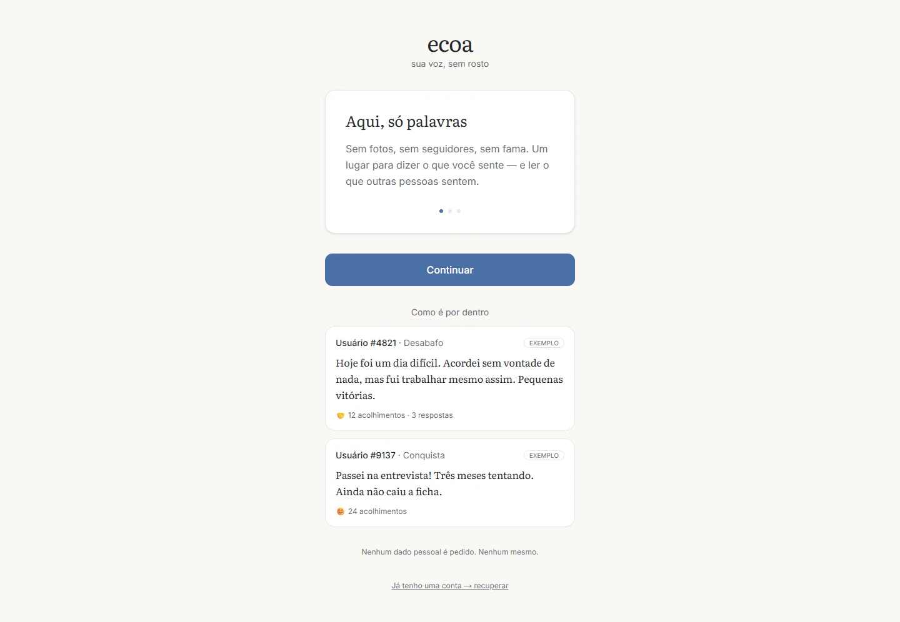

**English** · [Português](README.pt-BR.md)

# ECOA — anonymous, text-only social network

A 100% text, 100% anonymous social network for emotional expression: every person is just a number (`Usuário #4821`), with no photos, followers, links or engagement algorithm. Web MVP built with Next.js + Supabase, with layered moderation (deterministic rules + optional Claude Haiku, server-side only). The interface is in Brazilian Portuguese.

> **Type:** production (MVP) · **Demo:** https://ecoa-teal.vercel.app



<details>
<summary>One more screenshot</summary>


</details>

## Features

- **Anonymous identity:** one account per browser via Supabase anonymous auth (`signInAnonymously`); random public number assigned by a trigger; no browsable public profile.
- **De-anonymization protection:** `posts.user_id` and `comments.user_id` have SELECT **revoked at column level** — the client never reads the account↔content link; public authorship is only the `author_number`.
- **Content:** 1–2000 character posts in curated topics, 2-level comments, 6 empathetic reactions, post editing for 15 minutes, deletion with confirmation.
- **Feed:** chronological, topic filter, "load more" with keyset cursor and a take-a-break marker.
- **Moderation:** deterministic stage 0 (links, hate-speech blocklist, personal-data warning, crisis signals) + optional stage 2 with Claude Haiku. Reports hide content immediately for the reporter; 3 distinct reporters hide it for everyone until review.
- **Crisis support:** people writing about their own pain are never blocked — the composer shows CVV (188, Brazil's emotional support line) and publishes if the person wants to.
- **Account recovery:** 6-word phrase (bcrypt hash) that moves the account to another device.
- **LGPD (Brazilian data protection law):** `/privacidade` and `/regras` pages; `delete_me` removes profile, content and the auth user.
- **In-app notifications** for replies (no push).

## Stack

- **Next.js 16** (App Router, Turbopack, `src/proxy.ts` for session handling), React 19, Tailwind CSS v4, TypeScript
- **Supabase** (`@supabase/ssr`, `@supabase/supabase-js`): Postgres with RLS on all 8 tables + column privileges, anonymous auth, triggers (public number, stats, notifications), hardened `security definer` functions
- **Anthropic SDK** (`@anthropic-ai/sdk`) — used only in `web/src/lib/moderation.ts`, called from server actions; the key never reaches the browser

## Running locally

Prerequisites: Node.js 20.9+ and npm; a Supabase project.

In the Supabase project:

1. Apply the migrations in `web/supabase/migrations/` in order (0001 → 0004).
2. Enable **Allow anonymous sign-ins** (Authentication → Sign In / Providers).

```bash
cd web
npm ci
cp .env.example .env.local   # fill in the Supabase URL + publishable key
npm run dev
```

### Environment variables (`web/.env.example`)

| Variable | Required | Purpose |
|---|---|---|
| `NEXT_PUBLIC_SUPABASE_URL` | yes | Supabase project URL |
| `NEXT_PUBLIC_SUPABASE_PUBLISHABLE_KEY` | yes | Publishable key (public by design; RLS is the protection) |
| `ANTHROPIC_API_KEY` | no | Enables moderation stage 2; server-only, never with a `NEXT_PUBLIC_` prefix |

## Scripts (`web/`)

| Command | Description |
|---|---|
| `npm run dev` | Development server |
| `npm run build` | Production build |
| `npm run start` | Serve the build |
| `npm run lint` | ESLint |
| `node --env-file=.env.local scripts/e2e.mjs` | End-to-end database test (19 scenarios: column privacy, reports, recovery, LGPD deletion). **Creates and deletes anonymous accounts and content in the target Supabase project** — use a test project. |

## Structure

```
docs/                      # product blueprint, implementation status, UX audit (Portuguese)
web/
  src/
    proxy.ts               # refreshes session + redirects users without an account to /bem-vindo
    lib/
      supabase/            # browser/server clients (@supabase/ssr)
      moderation.ts        # moderation pipeline (rules + Claude Haiku, server-only)
      reactions.ts         # the 6 empathetic reactions
    app/
      actions.ts           # server actions (posts, comments, reactions, reports, LGPD)
      bem-vindo/           # 3-card onboarding + number reveal + account recovery
      (app)/               # tab-bar shell: feed, escrever, post/[id], voce, notificacoes, ajuda
      privacidade/ regras/ # public pages
  scripts/e2e.mjs          # end-to-end test against Supabase
  supabase/migrations/     # full schema (RLS, triggers, feed_posts view)
```

Product documentation (Portuguese): [docs/README.md](docs/README.md) · what was built: [docs/implementacao-status.md](docs/implementacao-status.md).

## Security and privacy decisions

- RLS enabled on all 8 tables; authorship columns with SELECT revoked.
- Reported content disappears from the reporter's feed immediately (`feed_posts` view).
- AI moderation is **fail-open by product decision**: without `ANTHROPIC_API_KEY`, or if the API is unavailable, only the deterministic stage 0 applies — an outage never blocks people from venting.

## Limitations

- Responsive web only (no native app); no search, no push notifications.
- Anti-bot protection limited to Supabase rate limits; an invisible CAPTCHA is recommended before wide promotion.
- Human review of reports is done through the Supabase dashboard (`reports` table).
- 3 pre-existing lint errors (`react-hooks/purity` and `react-hooks/set-state-in-effect` rules).

## Security

See [SECURITY.md](SECURITY.md) to report vulnerabilities. Please do not open public issues with vulnerability details.

## License

No license has been chosen yet; all rights reserved by the author.
